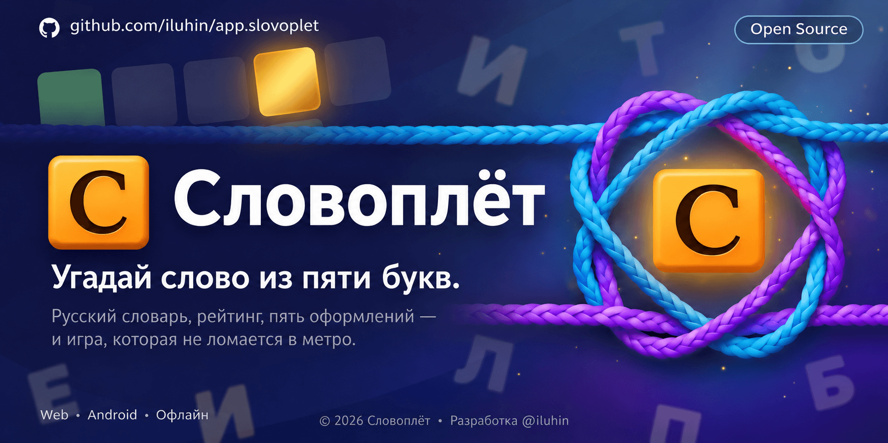

[Русский](README.md) · **English** · [Español](README.es.md) · [简体中文](README.zh-CN.md)

# Словоплёт

**Guess the five-letter word.** A Russian dictionary, a leaderboard, five themes —
and a game that holds up on the subway.

[**▶ Play in your browser**](https://5bukv.iluh.in/) ·
[**⬇ Download for Android**](https://5bukv.iluh.in/update.php?a=download) ·
[**📖 Wiki**](../../wiki)

---

## Rules

Enter a five-letter word — the game colors each letter:

| | |
|---|---|
| 🟩 | the letter is in the right place |
| 🟨 | the letter is in the word, but in a different place |
| ⬜ | the letter is not in the word |

You have five attempts. There are two modes: «Случайное слово» (Random Word)
and «Слово дня» (Word of the Day) — the same word for everyone until midnight.
Games count toward the overall leaderboard if you have created a profile;
you can also play as a guest.

## Android app

- **Plays offline.** The board, keyboard and dictionary are built into
  the app: a game starts instantly even without a connection. The Word of the Day
  and leaderboard still depend on the server — [here is why](../../wiki/Offline).
- **Has a personality.** The game occasionally comments on what is happening:
  it notices when you overuse a single letter, make three wrong guesses or win
  on your first attempt. No more than once per game, and never at the player's
  expense.
- **Fair timing.** The timer runs only while the game is open on screen:
  minimize it and the timer stops. A game stretched out by long pauses does not
  count toward your personal best time, so records can be compared fairly.
- **Lets you know about updates.** New versions are announced in the game,
  with a version number, file size and changelog. Your browser downloads the
  file and offers to install it. If you installed the game from a store, the
  store handles updates.
- **Opens on a home screen that invites you to play.** One screen: a question,
  a button and three navigation links. An unfinished game opens immediately,
  with no extra steps.
- **Nothing extra.** About 600 KB, with no ads or trackers. The game does not
  request any permissions you have to grant — no camera, contacts, location
  or package installation permissions.
- **Requires** Android 7.0 or later.

Get the file from the [releases page](../../releases) or directly
[from the website](https://5bukv.iluh.in/update.php?a=download) — it is signed
with the same key, so updates install over the existing game.

## Desktop and iPhone

The website is a PWA, so it installs like an ordinary app: its own window
with no address bar, an icon in the Start menu or on the Home screen, and it
starts without an internet connection.

- **Windows.** A Microsoft Store release is being prepared; the built
  packages are in [`msstore/`](msstore/). Until it is live, open
  [the game](https://5bukv.iluh.in) in Edge and click the install icon in the
  address bar — it is exactly the same app.
- **iPhone and iPad.** There is no separate app: «Поделиться» (Share) →
  «На экран „Домой“» (Add to Home Screen).
- **Chrome** on any system — the «⋮» menu → «Установить приложение»
  (Install app).

The Windows version has one property the APK does not: the package holds the
address of the website rather than a copy of the game, so new releases reach
it on their own, with no app update.

## AppGallery

In AppGallery the game ships under a different package name —
`com.iluhin.slovoplet` instead of `com.iluhin.fiveletters` — because the
store would not hand over the original one. That means the AppGallery build
will not update to the one from the website and vice versa, and both can sit
on the same phone. Your profile and statistics are shared either way: they
live on the server.

## Version history

All releases and their descriptions are on the [releases page](../../releases):
from the very first app shell, 1.4, to the current version. The newest file is
always available in the [latest release](../../releases/latest), and the
website serves the same file.

## What is in this repository

Only releases and information about the game: release notes, packages of
previous builds, the Microsoft Store packages and the wiki. The website and app source code is currently
closed.

This branch is the **stable channel**: the entire history of the game from
1.4 to the current version. There is also a [beta](../../tree/beta) branch —
a separate channel for testing partial app updates without reinstalling.
Its builds are marked as prereleases and do not appear under “Latest”.

## Questions and suggestions

[Issues](../../issues) — if the game rejects a valid word, something breaks
or you have an idea.

---

© Илья Анисимов · [iluh.in](https://iluh.in)
