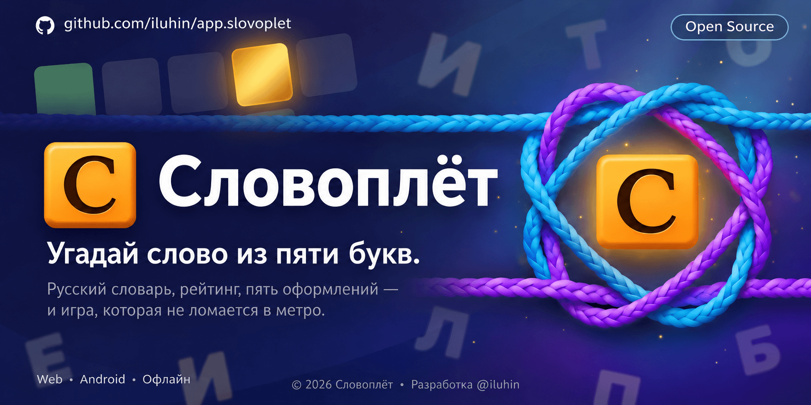

[Русский](README.md) · [English](README.en.md) · **Español** · [简体中文](README.zh-CN.md)

# Словоплёт

**Adivina la palabra de cinco letras.** Diccionario ruso, clasificación, cinco temas —
y un juego que sigue funcionando en el metro.

[**▶ Jugar en el navegador**](https://5bukv.iluh.in/) ·
[**⬇ Descargar para Android**](https://5bukv.iluh.in/update.php?a=download) ·
[**📖 Wiki**](../../wiki)

---

## Reglas

Introduce una palabra de cinco letras y el juego coloreará cada letra:

| | |
|---|---|
| 🟩 | la letra está en el lugar correcto |
| 🟨 | la letra aparece en la palabra, pero en otro lugar |
| ⬜ | la letra no aparece en la palabra |

Tienes cinco intentos. Hay dos modos: «Случайное слово» (Palabra aleatoria)
y «Слово дня» (Palabra del día), la misma para todos hasta medianoche.
Las partidas cuentan para la clasificación general si has creado un perfil;
también puedes jugar como invitado.

## Aplicación para Android

- **Funciona sin conexión.** El tablero, el teclado y el diccionario están
  incluidos en la aplicación: la partida empieza al instante, incluso sin
  conexión. La palabra del día y la clasificación siguen dependiendo del
  servidor — [por qué](../../wiki/Offline).
- **Tiene personalidad.** De vez en cuando, el juego comenta lo que ocurre:
  detecta si abusas de una misma letra, fallas tres palabras o ganas al primer
  intento. Como máximo una vez por partida, y nunca a costa del jugador.
- **Mide el tiempo con justicia.** El cronómetro solo avanza mientras el juego
  está abierto en pantalla: al minimizarlo, se detiene. Una partida alargada
  por pausas prolongadas no cuenta para tu récord personal de tiempo, por lo
  que los récords son comparables.
- **Avisa de las actualizaciones.** El juego anuncia las nuevas versiones
  con su número, tamaño y lista de cambios. El navegador descarga el archivo
  y ofrece instalarlo. Si instalaste el juego desde una tienda, esa tienda
  se encarga de actualizarlo.
- **Se abre en una pantalla de inicio que invita a jugar.** Una sola pantalla:
  una pregunta, un botón y tres enlaces de navegación. Las partidas sin terminar
  se abren directamente, sin pasos adicionales.
- **Nada de más.** Unos 600 KB, sin publicidad ni rastreadores. El juego no
  solicita ningún permiso que tengas que conceder: ni cámara, ni contactos,
  ni ubicación, ni instalación de paquetes.
- **Requiere** Android 7.0 o posterior.

Descarga el archivo de la [página de versiones](../../releases) o directamente
[del sitio web](https://5bukv.iluh.in/update.php?a=download): está firmado con
la misma clave, por lo que la actualización se instala sobre el juego existente.

## iPhone y ordenador

No hay una aplicación independiente para iPhone, pero el sitio web es una PWA:
«Поделиться» (Compartir) → «На экран „Домой“» (Añadir a la pantalla de inicio)
te proporciona un icono, permite abrir el juego sin barra de direcciones y
ofrece el mismo juego sin conexión. En Chrome para Android y ordenador,
usa el menú «⋮» → «Установить приложение» (Instalar aplicación).

## Historial de versiones

Todas las versiones y sus descripciones están en la [página de versiones](../../releases):
desde la primera aplicación contenedora, la 1.4, hasta la actual. El archivo más
reciente siempre está en la [última versión](../../releases/latest), y el sitio
web ofrece ese mismo archivo.

## Qué contiene este repositorio

Solo versiones e información sobre el juego: notas de las versiones, paquetes
de compilaciones anteriores y la wiki. El código fuente del sitio web y de
la aplicación sigue siendo cerrado por ahora.

Esta rama es el **canal estable**: toda la historia del juego desde la 1.4
hasta la versión actual. También existe la rama [beta](../../tree/beta), un
canal independiente donde se prueban las actualizaciones parciales de la
aplicación sin reinstalarla. Sus compilaciones se marcan como versiones
preliminares y no aparecen en «Latest».

## Preguntas y sugerencias

[Issues](../../issues): si el juego rechaza una palabra válida, algo falla
o tienes una idea.

---

© Илья Анисимов · [iluh.in](https://iluh.in)
