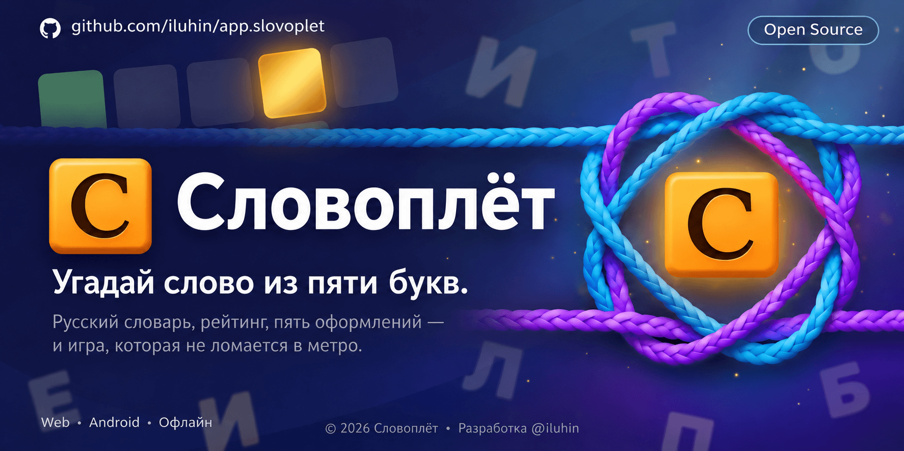

# Словоплёт

**Угадай слово из пяти букв.** Русский словарь, рейтинг, пять оформлений —
и игра, которая не ломается в метро.

[**▶ Играть в браузере**](https://5bukv.iluh.in/) ·
[**⬇ Скачать для Android**](https://5bukv.iluh.in/update.php?a=download) ·
[**📖 Вики**](../../wiki)

---

## Правила

Вы называете слово из пяти букв — игра красит каждую букву:

| | |
|---|---|
| 🟩 | буква на своём месте |
| 🟨 | буква в слове есть, но стоит в другом месте |
| ⬜ | такой буквы в слове нет |

Попыток пять. Есть два режима: «Случайное слово» и «Слово дня» — одно на всех
до полуночи. Партии идут в общий рейтинг, если вы завели профиль; играть
гостем тоже можно.

## Приложение для Android

- **Играет без интернета.** Поле, клавиатура и словарь лежат внутри
  приложения: партия начинается мгновенно даже без сети. Слово дня и рейтинг
  остаются серверными — [почему](../../wiki/Offline).
- **С характером.** Игра изредка комментирует происходящее: заметит перебор
  по одной букве, три слова мимо, победу с первой попытки. Не чаще одного
  раза за партию и никогда — над игроком.
- **Честное время.** Таймер идёт, только пока игра открыта на экране:
  свернули — остановился. Партия, растянутая на долгие паузы, в личный рекорд
  по времени не попадает, поэтому рекорды сравнимы между собой.
- **Сообщает об обновлении.** Новая версия приходит из игры, с номером,
  размером и списком изменений. Файл скачивает браузер, он же предлагает
  установку. Игру, поставленную из магазина, обновляет магазин.
- **Открывается на главной, которая зовёт играть.** Один экран: вопрос,
  кнопка и три перехода. Незаконченная партия открывается сразу, без лишних
  шагов.
- **Ничего лишнего.** Около 600 КБ, никакой рекламы и трекеров. Разрешений,
  которые нужно выдавать, игра не просит вовсе — ни камеры, ни контактов, ни
  геопозиции, ни установки пакетов.
- **Нужен** Android 7.0 или новее.

Файл берите [со страницы релизов](../../releases) или прямо
[с сайта](https://5bukv.iluh.in/update.php?a=download) — он подписан одним и
тем же ключом, поэтому обновление встаёт поверх установленной игры.

## Компьютер и iPhone

Сайт — это PWA, то есть его можно поставить как обычное приложение: своё
окно без адресной строки, иконка в меню «Пуск» или на экране «Домой», запуск
без интернета.

- **Windows.** Готовится выпуск в Microsoft Store; собранные пакеты лежат
  в [`msstore/`](msstore/). Пока его нет — откройте
  [игру](https://5bukv.iluh.in) в Edge и нажмите значок установки в адресной
  строке. Это ровно то же самое приложение.
- **iPhone и iPad.** Отдельного приложения нет: «Поделиться» → «На экран
  „Домой“».
- **Chrome** на любой системе — меню «⋮» → «Установить приложение».

У версии для Windows есть особенность, которой нет у APK: внутри пакета не
копия игры, а адрес сайта, поэтому новые выпуски доезжают до неё сами, без
обновления приложения.

## AppGallery

В AppGallery игра выходит под другим именем пакета —
`com.iluhin.slovoplet` вместо `com.iluhin.fiveletters`: прежнее имя магазин
не отдал. Это значит, что версия оттуда не обновится до версии с сайта и
наоборот, и обе могут стоять на одном телефоне. Профиль и статистика при
этом общие — они на сервере.

## История версий

Все выпуски с описанием — на [странице релизов](../../releases): от самой
первой оболочки 1.4 до текущей. Свежий файл всегда висит на
[последнем выпуске](../../releases/latest), и его же отдаёт сайт.

## Что внутри этого репозитория

Только выпуски и описание игры: заметки к версиям, пакеты прежних сборок,
пакеты для Microsoft Store и вики. Исходный код сайта и приложения пока
закрыт.

Эта ветка — **стабильный канал**: вся история игры от 1.4 до текущей версии.
Рядом есть ветка [beta](../../tree/beta) — отдельный канал, где проверяется
обновление приложения по частям, без переустановки. Её сборки помечены как
предварительные и не попадают в «Latest».

## Вопросы и пожелания

[Issues](../../issues) — если игра не приняла нормальное слово, что-то
сломалось или есть идея.

---

© Илья Анисимов · [iluh.in](https://iluh.in)
