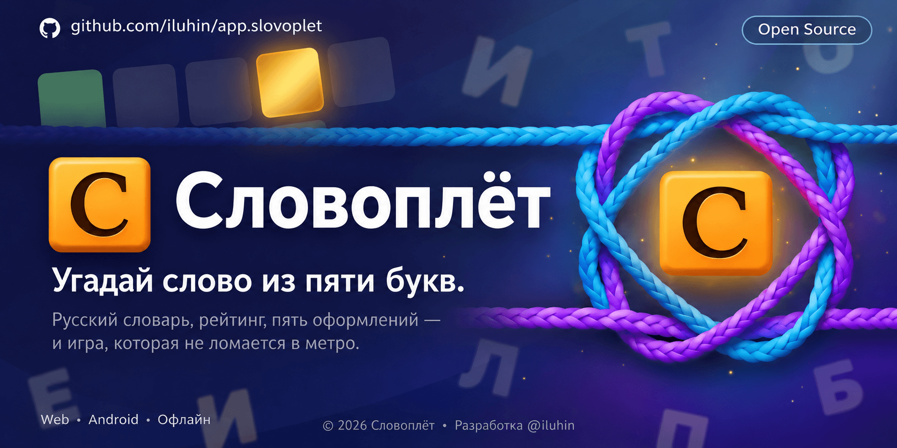

[Русский](README.md) · [English](README.en.md) · [Español](README.es.md) · **简体中文**

# Словоплёт

**猜出由五个字母组成的单词。** 俄语词典、排行榜、五种主题——
还有一款在地铁里也能正常玩的游戏。

[**▶ 在浏览器中游玩**](https://5bukv.iluh.in/) ·
[**⬇ 下载 Android 版**](https://5bukv.iluh.in/update.php?a=download) ·
[**📖 维基**](../../wiki)

---

## 游戏规则

输入一个由五个字母组成的单词，游戏会为每个字母标上颜色：

| | |
|---|---|
| 🟩 | 字母和位置都正确 |
| 🟨 | 单词中有这个字母，但位置不对 |
| ⬜ | 单词中没有这个字母 |

你有五次机会。游戏有两种模式：「Случайное слово」（随机单词）和
「Слово дня」（每日单词）。每日单词在午夜前对所有玩家都相同。
创建个人资料后，对局会计入总排行榜；也可以以访客身份游玩。

## Android 应用

- **支持离线游玩。** 棋盘、键盘和词典都内置于应用中：即使没有网络，
  也能立即开始一局。每日单词和排行榜仍依赖服务器——
  [原因见此](../../wiki/Offline)。
- **有自己的个性。** 游戏偶尔会点评一下当前情况：比如你过度使用同一个
  字母、连续猜错三个单词，或第一次就猜中。每局最多点评一次，绝不会
  拿玩家开涮。
- **公平计时。** 只有游戏在屏幕上打开时，计时器才会运行；将游戏最小化后，
  计时就会停止。因长时间暂停而拖长的对局不会计入个人最快纪录，
  因此各项纪录之间可以公平比较。
- **提供更新提示。** 游戏内会提示新版本，并显示版本号、文件大小和更新
  内容。浏览器负责下载文件，并提示安装。从应用商店安装的游戏则由
  应用商店更新。
- **打开就是让人想玩的首页。** 一个屏幕上只有一个问题、一个按钮和三个
  导航入口。如果有未完成的对局，会直接打开，无需额外操作。
- **没有多余的东西。** 大小约 600 KB，没有广告，也没有追踪器。游戏不会
  请求任何需要你授予的权限——不需要相机、通讯录、位置或安装软件包
  的权限。
- **需要** Android 7.0 或更高版本。

可以从[发布页面](../../releases)或直接
[从网站](https://5bukv.iluh.in/update.php?a=download)下载文件。文件使用
同一密钥签名，因此可以覆盖已安装的游戏进行更新。

## 电脑和 iPhone

网站是一个 PWA，可以像普通应用那样安装：拥有自己的窗口、不显示地址栏，
在「开始」菜单或主屏幕上有图标，即使没有网络也能启动。

- **Windows。** 正在准备上架 Microsoft Store，已构建好的安装包放在
  [`msstore/`](msstore/)。在上架之前，可以用 Edge 打开
  [游戏](https://5bukv.iluh.in)，点击地址栏中的安装图标——这就是同一个应用。
- **iPhone 和 iPad。** 没有独立应用：选择「Поделиться」（分享）→
  「На экран „Домой“」（添加到主屏幕）。
- **Chrome**（任意系统）：「⋮」菜单 →「Установить приложение」（安装应用）。

Windows 版有一点和 APK 不同：安装包里装的不是游戏的副本，而是网站的地址，
因此新版本会自动抵达，无需更新应用。

## AppGallery

在 AppGallery 上，游戏使用的包名不同——是 `com.iluhin.slovoplet`，
而不是 `com.iluhin.fiveletters`，因为商店没有把原来的包名给我们。
这意味着来自 AppGallery 的版本不会更新为网站上的版本，反之亦然，
两者可以同时装在一部手机上。不过个人资料和统计数据是共通的：它们保存在服务器上。

## 版本历史

所有版本及其说明都在[发布页面](../../releases)：从最早的 1.4 版应用外壳
到当前版本。[最新发布](../../releases/latest)中始终提供最新文件，网站
提供的也是同一个文件。

## 本仓库包含什么

仅包含发布版本和游戏说明：版本说明、以往构建的安装包、Microsoft Store 安装包和维基。
网站和应用的源代码目前尚未公开。

本分支是**稳定渠道**：包含从 1.4 到当前版本的完整游戏历史。
另有 [beta](../../tree/beta) 分支，这是一个独立渠道，用于测试无需重新
安装的应用局部更新。该渠道的构建会标记为预发布版本，不会出现在
「Latest」中。

## 问题与建议

[Issues](../../issues)——如果游戏不接受正常的单词、出现故障，
或你有新的想法，请在这里提出。

---

© Илья Анисимов · [iluh.in](https://iluh.in)
